# Inventory

Generated by `tools/gen_inventory.py` from the **latest GitHub release** of each repository (sizes are the released `.COM` files'),
so it can be refreshed after any release: `tools/gen_inventory.py > INVENTORY.md`.
Previews (`docs/thumbs/NAME.jpg`) are real DOSBox captures. Five micro demos have nothing to see (BUZZ, STATIC, TICKER, GEIGER, BREATH), so their preview is a plot of what the emulator says they write; see the micro-demos README.

**42 programs in 7 repositories.** 30 are under 9 bytes, 41 are 256 bytes or less, the smallest is BIG.COM (4 bytes), the largest UBERSHOW.COM (11,179 bytes).

## Repositories

| Repository | Holds | Latest release | Released | Programs |
|---|---|---|---|---|
| [uber10-dos-demo](https://github.com/djayuffe/uber10-dos-demo) | one demo | v1.1.0 | 2026-10-09 | 1 |
| [uber128-dos-demo](https://github.com/djayuffe/uber128-dos-demo) | one demo | v1.0.0 | 2026-10-09 | 1 |
| [uber256-dos-intro](https://github.com/djayuffe/uber256-dos-intro) | one demo | v1.1.0 | 2026-10-09 | 1 |
| [uber256-rotozoomer](https://github.com/djayuffe/uber256-rotozoomer) | one demo | v1.0.0 | 2026-10-09 | 1 |
| [uber256-lab](https://github.com/djayuffe/uber256-lab) | a collection | v1.4.0 | 2026-10-10 | 7 |
| [uber-micro-demos](https://github.com/djayuffe/uber-micro-demos) | a collection | v1.9.0 | 2026-10-10 | 30 |
| [uber40k-dos-demo](https://github.com/djayuffe/uber40k-dos-demo) | the big show | v1.4.0 | 2026-10-08 | 1 |

Also in the family but not counted above (no `.COM` in a current release): [uber256-megademo](https://github.com/djayuffe/uber256-megademo) is the earlier 18-scene line of the big show, superseded by uber40k-dos-demo; [uber-tiny-demos](https://github.com/djayuffe/uber-tiny-demos) is this index; releases v1.0.0 and v1.1.0 still carry the first 5 / 79 / 171-byte binaries.

## Every program, smallest first

| Preview | Bytes | Program | Repository | What it does |
|---|---:|---|---|---|
| 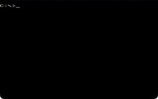 | 4 | `BIG.COM` | [uber-micro-demos](https://github.com/djayuffe/uber-micro-demos) |  |
| 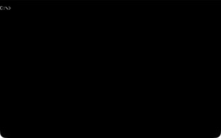 | 5 | `MODE3.COM` | [uber-micro-demos](https://github.com/djayuffe/uber-micro-demos) |  |
| 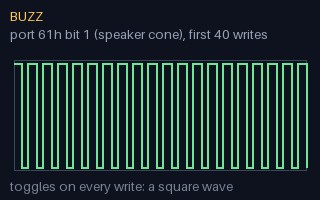 | 6 | `BUZZ.COM` | [uber-micro-demos](https://github.com/djayuffe/uber-micro-demos) |  |
| 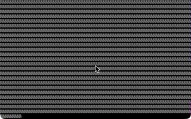 | 6 | `KEYSCAN.COM` | [uber-micro-demos](https://github.com/djayuffe/uber-micro-demos) |  |
| 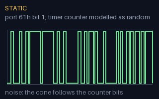 | 6 | `STATIC.COM` | [uber-micro-demos](https://github.com/djayuffe/uber-micro-demos) |  |
| 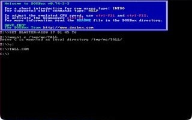 | 6 | `TALL.COM` | [uber-micro-demos](https://github.com/djayuffe/uber-micro-demos) |  |
| 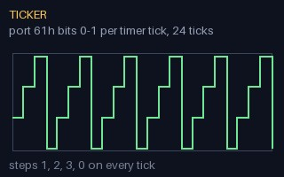 | 6 | `TICKER.COM` | [uber-micro-demos](https://github.com/djayuffe/uber-micro-demos) |  |
| 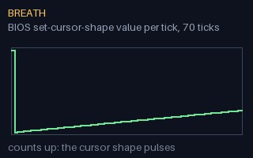 | 7 | `BREATH.COM` | [uber-micro-demos](https://github.com/djayuffe/uber-micro-demos) |  |
| 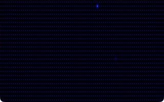 | 7 | `BULLETS.COM` | [uber-micro-demos](https://github.com/djayuffe/uber-micro-demos) |  |
| 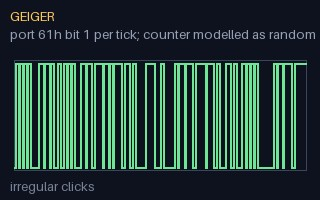 | 7 | `GEIGER.COM` | [uber-micro-demos](https://github.com/djayuffe/uber-micro-demos) |  |
| 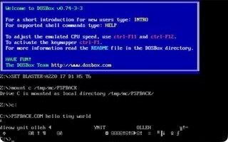 | 7 | `PSPBACK.COM` | [uber-micro-demos](https://github.com/djayuffe/uber-micro-demos) |  |
| 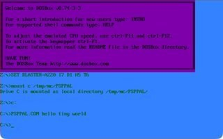 | 7 | `PSPPAL.COM` | [uber-micro-demos](https://github.com/djayuffe/uber-micro-demos) |  |
| 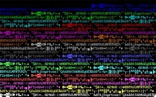 | 7 | `STACKMAP.COM` | [uber-micro-demos](https://github.com/djayuffe/uber-micro-demos) |  |
| 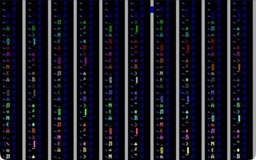 | 7 | `STATE.COM` | [uber-micro-demos](https://github.com/djayuffe/uber-micro-demos) |  |
| 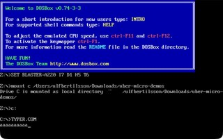 | 7 | `TYPER.COM` | [uber-micro-demos](https://github.com/djayuffe/uber-micro-demos) |  |
| 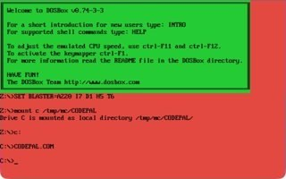 | 8 | `CODEPAL.COM` | [uber-micro-demos](https://github.com/djayuffe/uber-micro-demos) |  |
| 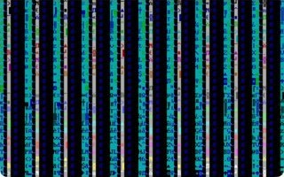 | 8 | `EVO1.COM` | [uber-micro-demos](https://github.com/djayuffe/uber-micro-demos) |  |
| 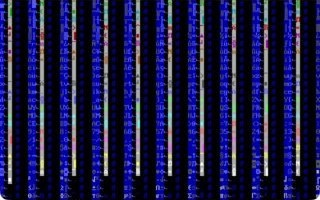 | 8 | `EVO2.COM` | [uber-micro-demos](https://github.com/djayuffe/uber-micro-demos) |  |
| 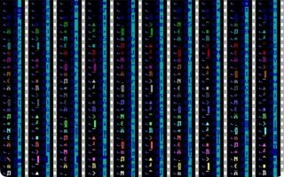 | 8 | `FLUX.COM` | [uber-micro-demos](https://github.com/djayuffe/uber-micro-demos) |  |
| 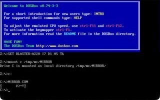 | 8 | `MIRROR.COM` | [uber-micro-demos](https://github.com/djayuffe/uber-micro-demos) |  |
| 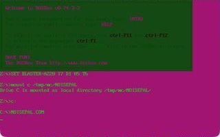 | 8 | `NOISEPAL.COM` | [uber-micro-demos](https://github.com/djayuffe/uber-micro-demos) |  |
| 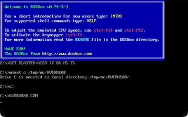 | 8 | `OVERHEAR.COM` | [uber-micro-demos](https://github.com/djayuffe/uber-micro-demos) |  |
| 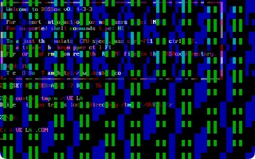 | 8 | `OVERLAP.COM` | [uber-micro-demos](https://github.com/djayuffe/uber-micro-demos) |  |
| 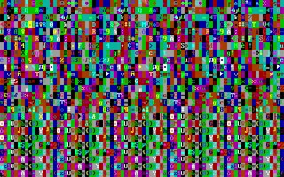 | 8 | `OVERMAX.COM` | [uber-micro-demos](https://github.com/djayuffe/uber-micro-demos) |  |
| 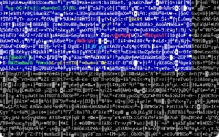 | 8 | `OVERSUB.COM` | [uber-micro-demos](https://github.com/djayuffe/uber-micro-demos) |  |
| 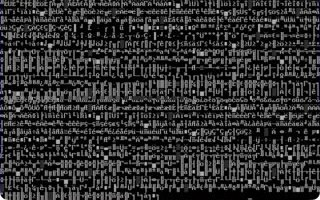 | 8 | `SNOW.COM` | [uber-micro-demos](https://github.com/djayuffe/uber-micro-demos) |  |
| 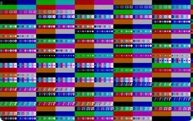 | 8 | `SPECTRUM.COM` | [uber-micro-demos](https://github.com/djayuffe/uber-micro-demos) |  |
| 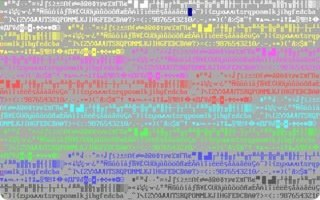 | 8 | `STKRAIN.COM` | [uber-micro-demos](https://github.com/djayuffe/uber-micro-demos) |  |
| 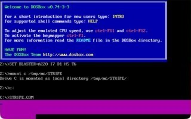 | 8 | `STRIPE.COM` | [uber-micro-demos](https://github.com/djayuffe/uber-micro-demos) |  |
| 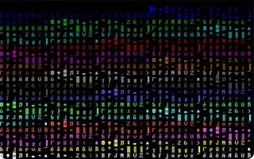 | 8 | `WEAVE.COM` | [uber-micro-demos](https://github.com/djayuffe/uber-micro-demos) |  |
| 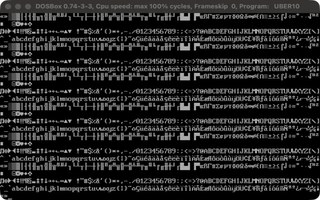 | 10 | `UBER10.COM` | [uber10-dos-demo](https://github.com/djayuffe/uber10-dos-demo) | a 10-byte ASCII scroller with sound |
| 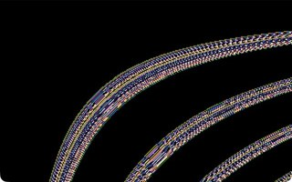 | 77 | `SELFTEX.COM` | [uber256-lab](https://github.com/djayuffe/uber256-lab) | Each pixel is a byte of the program's own machine code, picked by `x*y/64 + time`. The hyperbolic bands you see are the code. |
| 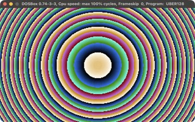 | 77 | `UBER128.COM` | [uber128-dos-demo](https://github.com/djayuffe/uber128-dos-demo) | rainbow rings flowing out of the screen centre |
| 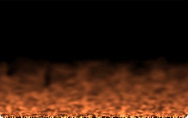 | 123 | `FIRE.COM` | [uber256-lab](https://github.com/djayuffe/uber256-lab) | Framebuffer feedback: each pixel becomes the average of four pixels below it, minus a little, with random heat injected at the bottom. A smoky turbulent fire, no FPU. |
| 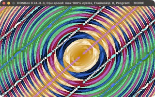 | 131 | `MOIRE.COM` | [uber256-dos-intro](https://github.com/djayuffe/uber256-dos-intro) | two ring families, one orbiting the other, XORed into a moire |
| 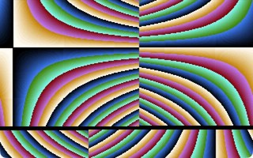 | 137 | `ESCHER.COM` | [uber256-lab](https://github.com/djayuffe/uber256-lab) | The picture is drawn once; after that only the CRT controller's start address and line-compare registers move, folding a hyperbolic texture into an impossible patchwork. No pixel is ever redrawn. |
| 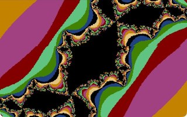 | 161 | `JULIA.COM` | [uber256-lab](https://github.com/djayuffe/uber256-lab) | A Julia set in 8.8 fixed point. Its constant circles on a Minsky oscillator, so the fractal continually changes shape. No FPU, no sine table. |
| 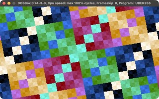 | 171 | `UBER256.COM` | [uber256-rotozoomer](https://github.com/djayuffe/uber256-rotozoomer) | an XOR rotozoomer with no multiplies and no sine table |
| 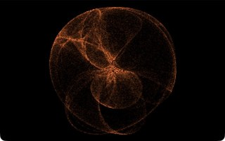 | 205 | `GALAXY.COM` | [uber256-lab](https://github.com/djayuffe/uber256-lab) | A de Jong strange attractor drawn as a glowing, fading, slowly morphing cloud. The orbit also tunes the PC speaker. |
| 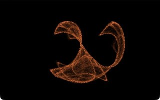 | 210 | `CLIFF.COM` | [uber256-lab](https://github.com/djayuffe/uber256-lab) | The same engine with Clifford-attractor equations and parameters: two curling wings over a web of caustics. |
| 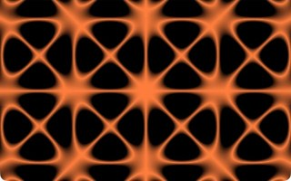 | 224 | `CHLADNI.COM` | [uber256-lab](https://github.com/djayuffe/uber256-lab) | The nodal lines of a vibrating plate, `sin(ax)sin(by) - sin(bx)sin(ay) = 0`, with drifting mode numbers that also tune the speaker. |
| 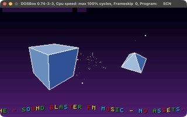 | 11,179 | `UBERSHOW.COM` | [uber40k-dos-demo](https://github.com/djayuffe/uber40k-dos-demo) | 20-scene show: 3D engine, starfield, scroller, Sound Blaster FM music |

## Size classes

| Class | Programs |
|---|---:|
| under 9 bytes | 30 |
| 9 to 64 | 1 |
| 65 to 128 | 3 |
| 129 to 256 | 7 |
| over 256 | 1 |
